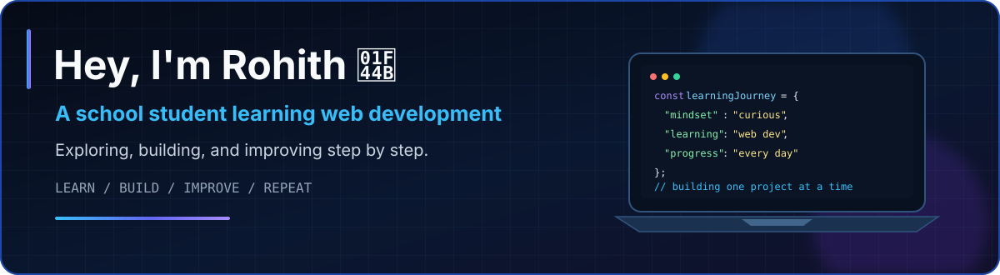
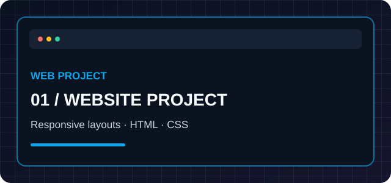
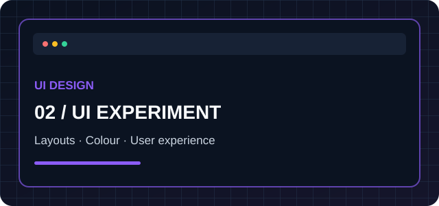
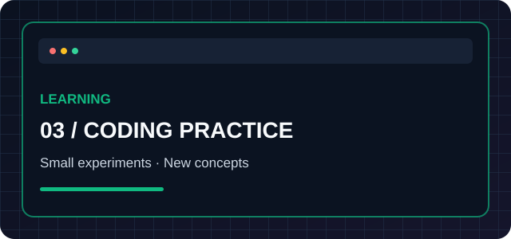
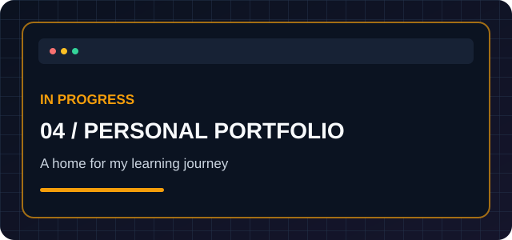

 

  
  

---

<table>
<tr>
<td width="54%" valign="top">

## 👋 About Me

Hey! I'm **Rohith**, a school student from India learning web development.

I enjoy exploring how websites work, experimenting with new tools, and turning ideas into small projects as I learn.

- 🎓 School student and technology enthusiast
- 🌐 Learning web development step by step
- 🧩 Practising through personal projects
- 📈 Focused on steady progress, not shortcuts

> 💬 *A student today, a better developer tomorrow.*

</td>
<td width="46%" valign="top">

## 📚 What I'm Learning

</td>
</tr>
</table>

## 🧰 My Learning Toolkit

---

## 🚀 Projects & Experiments

<i>These cards are project slots. Replace the examples below with your real repositories and screenshots.</i>

<table>
<tr>
<td width="50%" valign="top">

### 🌐 Website Project

A responsive website built while practising web development fundamentals.

[**Explore repositories →**](https://github.com/gtg-rohith-yt?tab=repositories)

</td>
<td width="50%" valign="top">

### 🎨 UI / Frontend Experiment

An experiment with layouts, colours, and responsive interface design.

[**Explore repositories →**](https://github.com/gtg-rohith-yt?tab=repositories)

</td>
</tr>
<tr>
<td width="50%" valign="top">

### ⚡ Coding Practice

Small coding exercises and experiments to improve programming fundamentals.

[**Explore repositories →**](https://github.com/gtg-rohith-yt?tab=repositories)

</td>
<td width="50%" valign="top">

### 💻 Personal Portfolio

A portfolio in progress to present my learning journey and projects.

[**Explore repositories →**](https://github.com/gtg-rohith-yt?tab=repositories)

</td>
</tr>
</table>

## 🎯 Goals

<table>
<tr>
<td width="50%" valign="top">

- 🔹 Build more complete websites
- 🔹 Improve JavaScript fundamentals
- 🔹 Learn responsive design patterns

</td>
<td width="50%" valign="top">

- 🔹 Explore React when ready
- 🔹 Learn how APIs work
- 🔹 Share projects and keep improving

</td>
</tr>
</table>

## 📊 GitHub Overview

---

### ✨ A student today, a better developer tomorrow.

Made with curiosity by Rohith 💙

